# 🚀 Career Launchpad — 26UAMPC204 Artificial Intelligence

📄 Printable handbook: [AI_Career_Launchpad.pdf](AI_Career_Launchpad.pdf)

## 🎓 By the end of this course you can …

- [x] Turn an open-ended problem into a precise AI specification (PEAS, states, actions, costs, goals).
- [x] Choose and implement the right search, optimisation or game-playing algorithm and analyse its complexity.
- [x] Encode domain knowledge as logic, rules or a knowledge graph and explain every inference.
- [x] Reason with probabilities, build a Bayesian network and plan under uncertainty.
- [x] Train, evaluate and interpret a learning model, and audit it for fairness and safety.
- [x] Build and demo an expert system or chatbot end to end, with documentation on GitHub.
- [x] Pitch an AI solution at a hackathon and turn an idea into a research proposal.

## 📦 End products every student walks out with

| Product | What it is |
|---|---|
| **GitHub portfolio** | 10 working lab notebooks + 5 assignment repositories with READMEs |
| **Mini-project** | Rule-based expert system or chatbot with explanation facility (Exp 10) |
| **Algorithm library** | Own implementations of BFS, DFS, UCS, A*, Minimax, CSP, unification, Bayes, ID3 |
| **Model card** | A documented, fairness-checked classifier (Assignment 5) |
| **Hackathon-ready team pitch** | A problem formulation and prototype plan for SIH / Kaggle / Solution Challenge |
| **Research starter** | One research idea with gap statement and baseline (08_Research_Ideas) |
| **Interview readiness** | 75 practised questions and 10 solved coding problems |

## 🏆 Top AI hackathons & competitions

> Windows were checked against the 2025–26 editions (November 2026). Dates move every year, so always confirm on the official site.

| Hackathon | Organiser | Level | Typical window | AI fit | Units |
|---|---|:-:|---|---|:-:|
| [**Smart India Hackathon (SIH) — Software Edition**](https://sih.gov.in) | Ministry of Education Innovation Cell & AICTE | National | Internal rounds Aug–Sep; Grand Finale in December (SIH 2025 finale: 8–9 Dec 2025) | Government problem statements; many need AI/ML, NLP, vision and optimisation | I–V |
| [**Microsoft Imagine Cup**](https://imaginecup.microsoft.com) | Microsoft | Global | Registration from about September; submissions in early January; world final at Microsoft Build (2026 final: 2 June 2026) | AI startups built on Microsoft AI and Azure | V |
| [**Google Solution Challenge (Build with AI)**](https://gdg.community.dev) | Google for Developers / GDG on Campus | Global / India | Kick-offs at GDG on Campus chapters around March–April | Solutions for the UN Sustainable Development Goals with Gemini, Firebase and Google Cloud | I, V |
| [**Amazon ML Challenge**](https://unstop.com) | Amazon India (on Unstop) | National | Registration around August–September; 72-hour online round; finale in October (2025 finale: 17 Oct 2025) | Real Amazon datasets; top teams get pre-placement interviews for Applied Scientist intern roles | IV, V |
| [**Flipkart GRiD**](https://unstop.com) | Flipkart | National | Registration mid-June to early July; national finals at Flipkart HQ, Bengaluru (GRiD 8.0 in 2026 added three tracks) | Engineering and data challenges with SDE / intern offers for finalists | II, V |
| [**Kaggle Competitions**](https://www.kaggle.com/competitions) | Kaggle (Google) | Global, year-round | Always open; featured, research, playground and community competitions | Supervised learning, NLP, vision, time series, reinforcement learning | II, IV, V |
| [**NASA International Space Apps Challenge**](https://www.spaceappschallenge.org) | NASA and partner space agencies | Global | Annual, usually a weekend in early October, with local events in India | Earth and space data, AI for climate, disaster and mapping problems | II, IV, V |
| [**Major League Hacking (MLH) season**](https://mlh.io/seasons) | MLH and member hackathons | Global, year-round | Weekend hackathons all year, many online; Indian college fests join the MLH season | Open themes; AI and agent tracks are common | I–V |

## 🎤 Top AI conferences

CORE ranks from the CORE portal; re-check before citing. `—` = national venue, not ranked by CORE.

| Venue | Full name | CORE | Units | Student entry point |
|---|---|:-:|:-:|---|
| **NeurIPS** | Conference on Neural Information Processing Systems — *Machine learning and deep learning* | `A*` | V | Workshops and the Datasets & Benchmarks track suit first papers |
| **ICML** | International Conference on Machine Learning — *Machine learning theory and practice* | `A*` | IV, V | Workshops accept short papers |
| **ICLR** | International Conference on Learning Representations — *Representation and deep learning* | `A*` | V | Open reviews on OpenReview are good reading |
| **AAAI** | AAAI Conference on Artificial Intelligence — *All of AI, including search, planning and knowledge* | `A*` | I–V | Student abstract and undergraduate consortium tracks |
| **IJCAI** | International Joint Conference on Artificial Intelligence — *All of AI* | `A*` | I–V | Doctoral consortium; demo track |
| **AAMAS** | Autonomous Agents and Multiagent Systems — *Agents, multi-agent systems, game theory* | `A*` | I, II | Extended abstracts for early work |
| **ICAPS** | International Conference on Automated Planning and Scheduling — *Planning, scheduling, PDDL* | `A*` | II, IV | Workshops and planning competitions (IPC) |
| **KR** | Principles of Knowledge Representation and Reasoning — *Logic, ontologies, reasoning* | `A*` | III | Good fit for logic-based projects |
| **ACL / EMNLP** | Association for Computational Linguistics / Empirical Methods in NLP — *Natural language processing* | `A*` | V | Student research workshop at ACL |
| **CVPR / ICCV** | Computer Vision and Pattern Recognition / International Conference on Computer Vision — *Computer vision* | `A*` | V | Workshops on applied vision |
| **KDD** | ACM SIGKDD Conference on Knowledge Discovery and Data Mining — *Data mining, applied data science* | `A*` | IV, V | Applied data science track |
| **UAI** | Conference on Uncertainty in Artificial Intelligence — *Probabilistic reasoning, Bayesian networks* | `A` | IV | Ideal for Unit IV research |
| **AISTATS** | Artificial Intelligence and Statistics — *Statistical machine learning* | `A` | IV, V | Strong for probabilistic methods |
| **ECAI** | European Conference on Artificial Intelligence — *All of AI* | `A` | I–V | Accessible broad venue |
| **CODS-COMAD** | ACM India Joint International Conference on Data Science & Management of Data — *Data science (India)* | `—` | IV, V | Young researchers' symposium; good first venue in India |
| **ICON** | International Conference on Natural Language Processing (India) — *NLP for Indian languages* | `—` | V | Fits Marathi / Hindi NLP projects |
| **ICVGIP** | Indian Conference on Computer Vision, Graphics and Image Processing — *Vision and graphics (India)* | `—` | V | Strong Indian vision community |

## 📚 Top AI journals

| Journal | Publisher | Units | Focus | Standing |
|---|---|:-:|---|---|
| **Artificial Intelligence (AIJ)** | Elsevier | I–V | Foundational AI: search, logic, planning, learning | Flagship AI journal |
| **Journal of Artificial Intelligence Research (JAIR)** | AI Access Foundation (open access) | I–V | All of AI | Flagship, open access |
| **Journal of Machine Learning Research (JMLR)** | JMLR (open access) | V | Machine learning | Flagship, open access |
| **Transactions on Machine Learning Research (TMLR)** | OpenReview (open access) | V | Machine learning | Rolling reviews |
| **IEEE Transactions on Pattern Analysis and Machine Intelligence (TPAMI)** | IEEE | V | Vision and learning | Top-tier IEEE Transactions |
| **IEEE Transactions on Neural Networks and Learning Systems (TNNLS)** | IEEE | V | Neural networks and learning | IEEE Transactions |
| **IEEE Transactions on Artificial Intelligence (TAI)** | IEEE | I–V | Broad AI | IEEE Transactions |
| **IEEE Transactions on Fuzzy Systems** | IEEE | IV | Fuzzy logic and systems | Leading fuzzy-systems journal |
| **Knowledge-Based Systems** | Elsevier | III, V | Knowledge representation, intelligent systems | Q1 applied AI |
| **Expert Systems with Applications** | Elsevier | III, V | Expert systems and applied AI | Q1 applied AI |
| **Engineering Applications of Artificial Intelligence** | Elsevier | II, IV, V | AI in engineering | Q1 applied AI |
| **Neural Networks** | Elsevier | V | Neural computation | Q1 |
| **Pattern Recognition** | Elsevier | V | Pattern recognition and vision | Q1 |
| **International Journal of Approximate Reasoning** | Elsevier | IV | Uncertainty, Bayesian networks, fuzzy reasoning | Specialist venue for Unit IV |
| **Nature Machine Intelligence** | Springer Nature | V | High-impact AI across disciplines | Highly selective |
| **IEEE Access** | IEEE (open access) | I–V | Multidisciplinary engineering incl. AI | Fast open-access venue for student work |

> ⚠️ **Avoid predatory venues:** check Scopus / Web of Science indexing (or UGC-CARE where required), never pay to publish without real peer review, and ignore unsolicited "fast acceptance" e-mails.

