<p align="center">
  
</p>

<p align="center">
  
  
  
  
  
  
  
</p>

<p align="center">
  <a href="#-syllabus"></a>
  <a href="#-learning-pathway"></a>
  <a href="#-laboratory"></a>
  <a href="#-assessment"></a>
  <a href="#-course-materials"></a>
  <a href="#-assignments"></a>
  <a href="#-research-ideas"></a>
  <a href="#-interview--industry-readiness"></a>
  <a href="#-career-launchpad-hackathons-conferences--journals"></a>
  <a href="#-end-of-course-skill-outcome"></a>
</p>

<p align="center">
  
</p>

> **Sanjivani University · Department of Artificial Intelligence & Data Science · Kopargaon, Maharashtra**<br>
> Integrated Theory + Practical course for DSY / SY B.Tech AI & ML. Prerequisites: Programming (C / Python), Data Structures and Algorithms, Discrete Mathematics.

---

## 📘 Syllabus

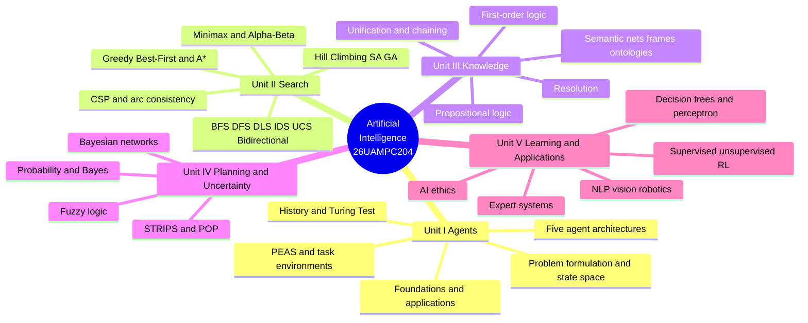

<details open>
<summary><b>🟦 UNIT I — Introduction to AI and Intelligent Agents</b> &nbsp;·&nbsp; <code>06 Hrs</code> &nbsp;·&nbsp; <code>CO204.1</code></summary>
<br>

| Topics | |
|---|---|
| **Introduction to AI** | definitions · history and evolution of AI · the Turing Test · foundations of AI · applications of AI |
| **Intelligent agents** | agents and environments · the concept of rationality · the PEAS framework · nature and properties of task environments |
| **Structure of agents** | simple-reflex · model-based reflex · goal-based · utility-based · learning agents |
| **Problem-solving agents** | problem formulation · well-defined problems and solutions · state-space representation |

📄 [Notes](01_Unit_Notes/pdf/Unit_1_Notes.pdf) · 🎞️ [PPT](02_PPT/Unit_1_AI_26UAMPC204.pptx) ([PDF](02_PPT/pdf/Unit_1_AI_26UAMPC204.pdf)) · 🧪 [Exp 1](06_Notebooks/Exp01_BFS_DFS_WaterJug_8Puzzle.ipynb) · 📝 [Assignment 1](09_Assignments/notebooks/Assignment_1_Starter.ipynb) · 🔬 [Research](08_Research_Ideas/README.md#unit-i-introduction-to-ai-and-intelligent-agents) · 💼 [Interview Qs](07_Interview_Prep/README.md#unit-i-introduction-to-ai-and-intelligent-agents-co2041)
</details>

<details>
<summary><b>🟩 UNIT II — Problem Solving by Search</b> &nbsp;·&nbsp; <code>06 Hrs</code> &nbsp;·&nbsp; <code>CO204.2</code></summary>
<br>

| Topics | |
|---|---|
| **Uninformed search** | Breadth-First · Depth-First · Depth-Limited · Iterative-Deepening · Uniform-Cost · Bidirectional |
| **Informed (heuristic) search** | heuristic functions · Greedy Best-First · A* · admissibility and consistency |
| **Local search and optimisation** | Hill Climbing · Simulated Annealing · Genetic Algorithms |
| **Adversarial search** | game playing · Minimax · Alpha-Beta pruning |
| **Constraint Satisfaction Problems** | backtracking search · constraint propagation · arc consistency |

📄 [Notes](01_Unit_Notes/pdf/Unit_2_Notes.pdf) · 🎞️ [PPT](02_PPT/Unit_2_AI_26UAMPC204.pptx) ([PDF](02_PPT/pdf/Unit_2_AI_26UAMPC204.pdf)) · 🧪 [Exp 2](06_Notebooks/Exp02_AStar_8Puzzle_Route.ipynb) [3](06_Notebooks/Exp03_HillClimbing_BestFirst.ipynb) [4](06_Notebooks/Exp04_Minimax_AlphaBeta_TicTacToe.ipynb) [5](06_Notebooks/Exp05_CSP_NQueens_MapColour_Sudoku.ipynb) · 📝 [Assignment 2](09_Assignments/notebooks/Assignment_2_Starter.ipynb) · 🔬 [Research](08_Research_Ideas/README.md#unit-ii-problem-solving-by-search) · 💼 [Interview Qs](07_Interview_Prep/README.md#unit-ii-problem-solving-by-search-co2042)
</details>

<details>
<summary><b>🟨 UNIT III — Knowledge Representation and Reasoning</b> &nbsp;·&nbsp; <code>06 Hrs</code> &nbsp;·&nbsp; <code>CO204.3</code></summary>
<br>

| Topics | |
|---|---|
| **Knowledge-based agents** | knowledge base · TELL / ASK · inference engine |
| **Propositional logic** | syntax · semantics · logical equivalence · validity · inference |
| **First-Order (Predicate) Logic** | syntax and semantics · quantifiers · representing knowledge in FOL |
| **Inference in FOL** | unification · forward chaining · backward chaining · resolution |
| **Structured knowledge representation** | semantic networks · frames · ontologies |

📄 [Notes](01_Unit_Notes/pdf/Unit_3_Notes.pdf) · 🎞️ [PPT](02_PPT/Unit_3_AI_26UAMPC204.pptx) ([PDF](02_PPT/pdf/Unit_3_AI_26UAMPC204.pdf)) · 🧪 [Exp 6](06_Notebooks/Exp06_Logic_Facts_Rules_Inference.ipynb) [7](06_Notebooks/Exp07_Unification_Resolution_FOL.ipynb) · 📝 [Assignment 3](09_Assignments/notebooks/Assignment_3_Starter.ipynb) · 🔬 [Research](08_Research_Ideas/README.md#unit-iii-knowledge-representation-and-reasoning) · 💼 [Interview Qs](07_Interview_Prep/README.md#unit-iii-knowledge-representation-and-reasoning-co2043)
</details>

<details>
<summary><b>🟧 UNIT IV — Planning and Reasoning under Uncertainty</b> &nbsp;·&nbsp; <code>06 Hrs</code> &nbsp;·&nbsp; <code>CO204.4</code></summary>
<br>

| Topics | |
|---|---|
| **Classical planning** | components of a planning system · STRIPS representation · state-space search for planning · partial-order planning |
| **Reasoning under uncertainty** | sources of uncertainty · basics of probability · Bayes' theorem |
| **Bayesian (belief) networks** | representation · simple inference |
| **Fuzzy logic** | fuzzy sets · membership functions · fuzzy inference |

📄 [Notes](01_Unit_Notes/pdf/Unit_4_Notes.pdf) · 🎞️ [PPT](02_PPT/Unit_4_AI_26UAMPC204.pptx) ([PDF](02_PPT/pdf/Unit_4_AI_26UAMPC204.pdf)) · 🧪 [Exp 8](06_Notebooks/Exp08_Bayes_BayesianNetwork_Diagnosis.ipynb) · 📝 [Assignment 4](09_Assignments/notebooks/Assignment_4_Starter.ipynb) · 🔬 [Research](08_Research_Ideas/README.md#unit-iv-planning-and-reasoning-under-uncertainty) · 💼 [Interview Qs](07_Interview_Prep/README.md#unit-iv-planning-and-reasoning-under-uncertainty-co2044)
</details>

<details>
<summary><b>🟥 UNIT V — Learning, Expert Systems and Applications of AI</b> &nbsp;·&nbsp; <code>06 Hrs</code> &nbsp;·&nbsp; <code>CO204.5</code></summary>
<br>

| Topics | |
|---|---|
| **Introduction to learning** | supervised · unsupervised · reinforcement learning (overview) |
| **Learning models** | learning by decision trees · artificial neural networks · the perceptron |
| **Expert systems** | architecture · knowledge acquisition · inference engine · rule-based reasoning |
| **Applications of AI** | natural language processing · computer vision · robotics (overview) |
| **Ethics** | ethical and societal issues in Artificial Intelligence |

📄 [Notes](01_Unit_Notes/pdf/Unit_5_Notes.pdf) · 🎞️ [PPT](02_PPT/Unit_5_AI_26UAMPC204.pptx) ([PDF](02_PPT/pdf/Unit_5_AI_26UAMPC204.pdf)) · 🧪 [Exp 9](06_Notebooks/Exp09_DecisionTree_Rules.ipynb) [10](06_Notebooks/Exp10_ExpertSystem_Chatbot.ipynb) · 📝 [Assignment 5](09_Assignments/notebooks/Assignment_5_Starter.ipynb) · 🔬 [Research](08_Research_Ideas/README.md#unit-v-learning-expert-systems-and-applications-of-ai) · 💼 [Interview Qs](07_Interview_Prep/README.md#unit-v-learning-expert-systems-and-applications-of-ai-co2045)
</details>

<p align="right"><b>Total: 30 hours of classroom instruction + 30 hours of laboratory + 30 hours of self-learning</b></p>

### 🎯 Course Outcomes

| CO | After completing the course, students will be able to … | Bloom's |
|:-:|---|:-:|
| **CO204.1** | Explain the foundations and applications of AI and the concept of intelligent agents, and formulate real-world problems as state-space search problems. | `L2` `L3` |
| **CO204.2** | Apply uninformed, informed (heuristic), local and adversarial search techniques, along with constraint satisfaction, to solve problems. | `L3` |
| **CO204.3** | Represent knowledge and perform logical inference using propositional logic and first-order (predicate) logic. | `L3` |
| **CO204.4** | Apply classical planning and reasoning under uncertainty using probability, Bayesian networks and fuzzy logic. | `L3` |
| **CO204.5** | Illustrate the fundamentals of learning, expert systems and real-world applications of AI with awareness of ethical issues. | `L2` `L4` |

<details>
<summary><b>🔥 CO–PO / PSO mapping heat-map</b> &nbsp; 🟩 High (3) · 🟨 Medium (2) · 🟧 Low (1) · ⬜ None</summary>
<br>

| | PO1 | PO2 | PO3 | PO4 | PO5 | PO6 | PO7 | PO8 | PO9 | PO10 | PO11 | PO12 | PSO1 | PSO2 | PSO3 |
|---|:-:|:-:|:-:|:-:|:-:|:-:|:-:|:-:|:-:|:-:|:-:|:-:|:-:|:-:|:-:|
| **CO204.1** | 🟩 | 🟨 | 🟧 | 🟧 | 🟧 | ⬜ | 🟧 | ⬜ | 🟨 | 🟨 | 🟧 | 🟨 | 🟩 | 🟨 | ⬜ |
| **CO204.2** | 🟩 | 🟩 | 🟩 | 🟨 | 🟨 | ⬜ | 🟧 | ⬜ | 🟨 | 🟨 | 🟧 | 🟨 | 🟩 | 🟨 | ⬜ |
| **CO204.3** | 🟩 | 🟩 | 🟨 | 🟨 | 🟧 | 🟧 | 🟧 | 🟨 | 🟨 | 🟨 | 🟧 | 🟨 | 🟩 | 🟨 | ⬜ |
| **CO204.4** | 🟩 | 🟩 | 🟨 | 🟩 | 🟨 | 🟧 | 🟨 | 🟧 | 🟨 | 🟩 | 🟨 | 🟩 | 🟩 | 🟩 | 🟨 |
| **CO204.5** | 🟨 | 🟨 | 🟨 | 🟨 | 🟨 | 🟨 | 🟨 | 🟩 | 🟨 | 🟨 | 🟨 | 🟩 | 🟩 | 🟨 | 🟨 |

</details>

---

## 🧭 Learning pathway

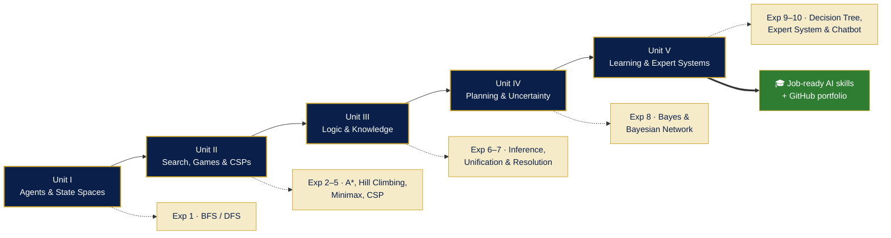

### 🗓️ Suggested 15-week teaching plan

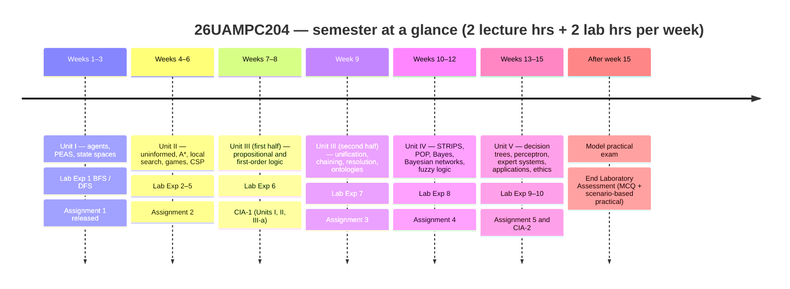

---

## 🧪 Laboratory

| Exp | Practical title | CO | ▶️ Notebook | 🐍 Script |
|:-:|---|:-:|:-:|:-:|
| 1 | Uninformed search (BFS and DFS) for the Water-Jug / 8-puzzle problem | CO204.1 | [ipynb](06_Notebooks/Exp01_BFS_DFS_WaterJug_8Puzzle.ipynb) | [py](06_Notebooks/python/Exp01_BFS_DFS_WaterJug_8Puzzle.py) |
| 2 | A* search with an admissible heuristic for the 8-puzzle or shortest route | CO204.2 | [ipynb](06_Notebooks/Exp02_AStar_8Puzzle_Route.ipynb) | [py](06_Notebooks/python/Exp02_AStar_8Puzzle_Route.py) |
| 3 | Hill Climbing / Best-First Search for a state-space problem | CO204.2 | [ipynb](06_Notebooks/Exp03_HillClimbing_BestFirst.ipynb) | [py](06_Notebooks/python/Exp03_HillClimbing_BestFirst.py) |
| 4 | Game playing with Minimax and Alpha-Beta pruning (Tic-Tac-Toe) | CO204.2 | [ipynb](06_Notebooks/Exp04_Minimax_AlphaBeta_TicTacToe.ipynb) | [py](06_Notebooks/python/Exp04_Minimax_AlphaBeta_TicTacToe.py) |
| 5 | CSP (N-Queens / Map Colouring / Sudoku) by backtracking | CO204.2 | [ipynb](06_Notebooks/Exp05_CSP_NQueens_MapColour_Sudoku.ipynb) | [py](06_Notebooks/python/Exp05_CSP_NQueens_MapColour_Sudoku.py) |
| 6 | Facts and rules with logical inference (Prolog-style in Python) | CO204.3 | [ipynb](06_Notebooks/Exp06_Logic_Facts_Rules_Inference.ipynb) | [py](06_Notebooks/python/Exp06_Logic_Facts_Rules_Inference.py) |
| 7 | Unification and resolution for first-order logic | CO204.3 | [ipynb](06_Notebooks/Exp07_Unification_Resolution_FOL.ipynb) | [py](06_Notebooks/python/Exp07_Unification_Resolution_FOL.py) |
| 8 | Bayes' theorem / Bayesian network for diagnostic reasoning | CO204.4 | [ipynb](06_Notebooks/Exp08_Bayes_BayesianNetwork_Diagnosis.ipynb) | [py](06_Notebooks/python/Exp08_Bayes_BayesianNetwork_Diagnosis.py) |
| 9 | Decision-tree classifier and the rules learned | CO204.5 | [ipynb](06_Notebooks/Exp09_DecisionTree_Rules.ipynb) | [py](06_Notebooks/python/Exp09_DecisionTree_Rules.py) |
| 10 | Mini-project: rule-based expert system and a basic chatbot | CO204.5 | [ipynb](06_Notebooks/Exp10_ExpertSystem_Chatbot.ipynb) | [py](06_Notebooks/python/Exp10_ExpertSystem_Chatbot.py) |

**📗 Two lab manuals**

| Edition | What it is | Files |
|---|---|---|
| **DSY Official Edition** | The department's official lab manual for DSY – AI & ML students (50 pages) with its all-experiments notebook | [PDF](05_Lab_Manual/DSY_Official_Edition/AI_Lab_Manual_26UAMPC204.pdf) · [LaTeX](05_Lab_Manual/DSY_Official_Edition/AI_Lab_Manual_26UAMPC204.tex) · [Notebook](05_Lab_Manual/DSY_Official_Edition/AI_Lab_26UAMPC204_All_Experiments.ipynb) |
| **Handbook Edition** | Generated from the executed notebooks in `06_Notebooks`, with real outputs and embedded animations | [PDF](05_Lab_Manual/AI_Lab_Manual_26UAMPC204.pdf) · [LaTeX](05_Lab_Manual/AI_Lab_Manual_26UAMPC204.tex) |

### 🎬 Algorithm animations (generated by the lab notebooks)

<table>
<tr>
<td align="center">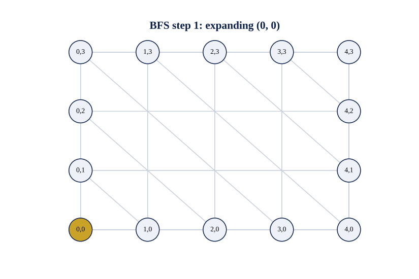<br><b>Exp 1</b> · BFS on the Water-Jug state space</td>
<td align="center">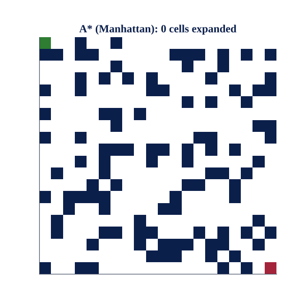<br><b>Exp 2</b> · A* (Manhattan) path-finding</td>
<td align="center">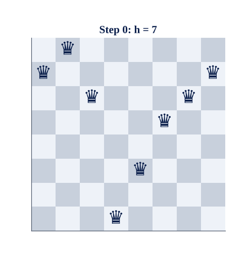<br><b>Exp 3</b> · Hill climbing on 8-Queens</td>
</tr>
<tr>
<td align="center">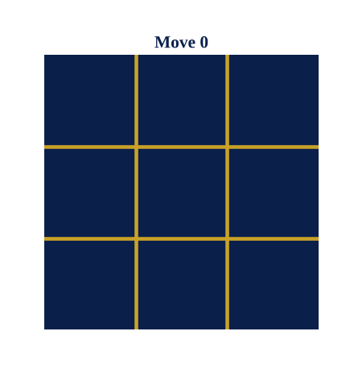<br><b>Exp 4</b> · Minimax + α–β self-play</td>
<td align="center">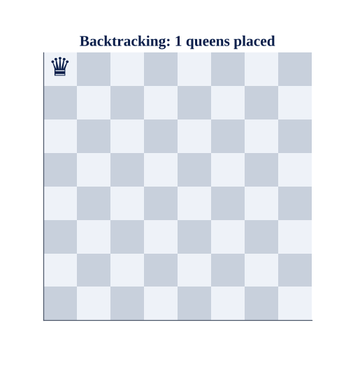<br><b>Exp 5</b> · CSP backtracking</td>
<td align="center">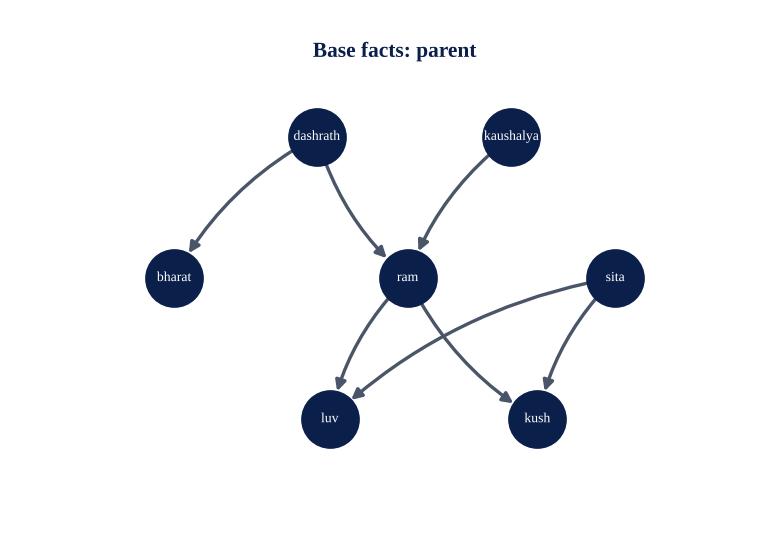<br><b>Exp 6</b> · Forward chaining on a family KB</td>
</tr>
<tr>
<td align="center">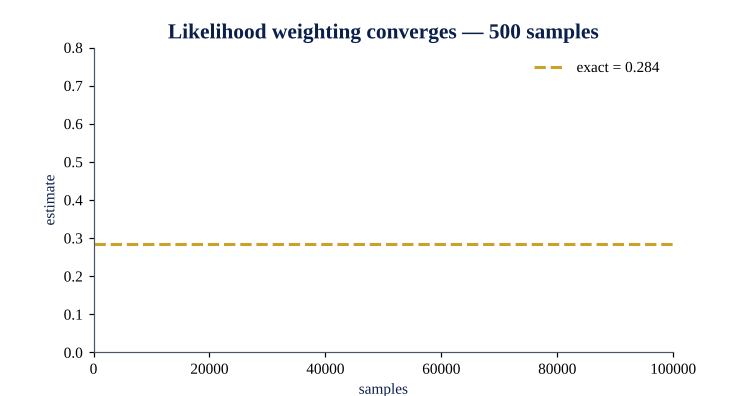<br><b>Exp 8</b> · Bayesian network sampling</td>
<td align="center">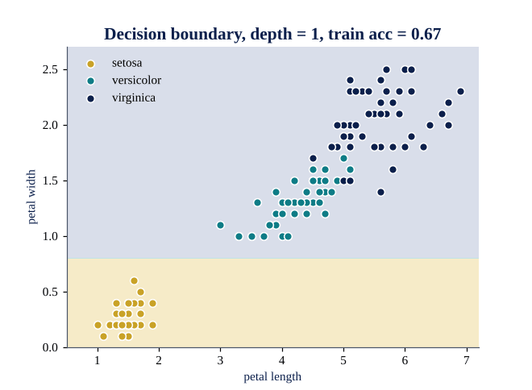<br><b>Exp 9</b> · Decision-tree boundaries vs depth</td>
<td align="center">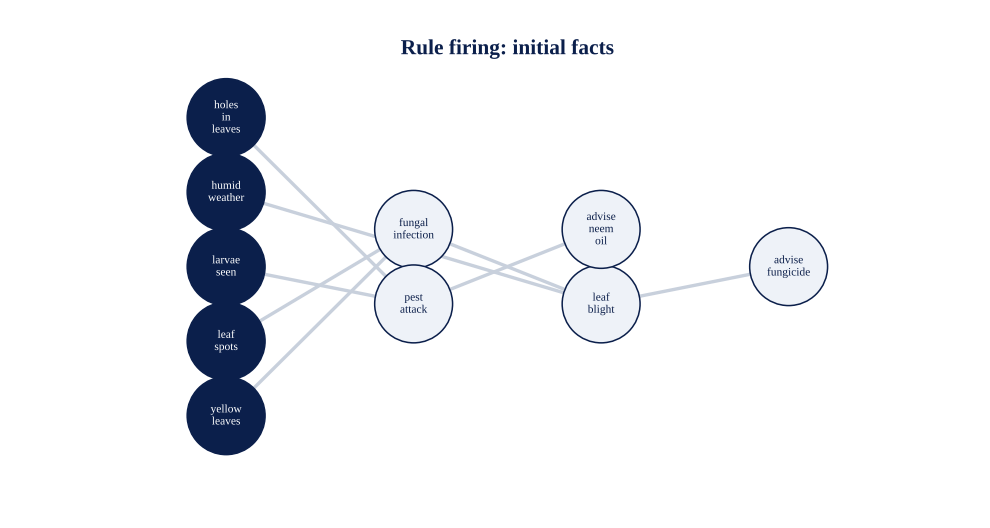<br><b>Exp 10</b> · Expert-system rule firing</td>
</tr>
</table>

---

## 📊 Assessment

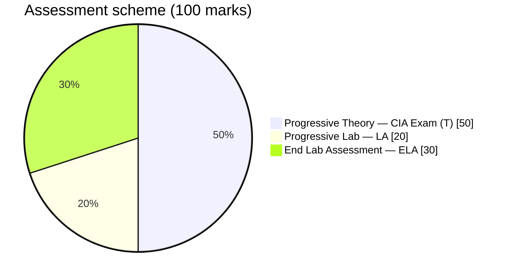

<details>
<summary><b>Teaching, learning and assessment (TLA) scheme</b></summary>
<br>

| Classroom (L) | Lab (P) | Self-learning | Total hours | Credits | CIA Exam (T) | Lab (LA) | End Lab (ELA) | Total |
|:-:|:-:|:-:|:-:|:-:|:-:|:-:|:-:|:-:|
| 30 | 30 | 30 | 90 | 90 / 30 = **3** | 50 | 20 | 30 | **100** |

</details>

<details>
<summary><b>A. CIA exam specification (50 marks)</b></summary>
<br>

| CIA | Unit | CO | Marks | Remember & Understand | Apply · Analyse · Evaluate · Create |
|:-:|---|:-:|:-:|:-:|:-:|
| CIA-1 | Unit I | CO204.1 | 10 | 04 | 06 |
| CIA-1 | Unit II | CO204.2 | 10 | 04 | 06 |
| CIA-1 | Unit III (first half) | CO204.3 | 05 | 02 | 03 |
| CIA-2 | Unit III (second half) | CO204.3 | 05 | 02 | 03 |
| CIA-2 | Unit IV | CO204.4 | 10 | 04 | 06 |
| CIA-2 | Unit V | CO204.5 | 10 | 04 | 06 |
| | **Total** | | **50** | **20** | **30** |

</details>

<details>
<summary><b>B. Progressive lab (20 marks) and C. End lab assessment (30 marks)</b></summary>
<br>

- **Progressive lab (LA):** each of the 10 experiments is assessed out of 10 (average = 10 marks); **Capstone model** = lab performance (10) + CIA practical exam (10) = **20 marks**.
- **Rubric criteria:** attendance & punctuality · preparation & understanding · execution · problem solving · collaboration · accuracy of results · lab report · presentation · viva voce (Excellent 4–5 · Good 3 · Satisfactory 2 · Needs improvement 1).
- **End lab (ELA), 2 hours:** MCQ (20) + practical scenario-based exam (40) = 60, scaled to **30 marks**.

</details>

---

## 🗂️ Course materials

| | Component | What you get | Formats |
|:-:|---|---|---|
| 📄 | [**Unit-wise Lecture Notes**](01_Unit_Notes/pdf) | 5 units with definition / example / pitfall boxes, TikZ diagrams, worked examples and an Industry Readiness section | `LaTeX` · `PDF` |
| 🎞️ | [**Animated PowerPoint Decks**](02_PPT) | 5 decks (~16 slides each) with entrance animations, native charts, skills and interview slides | `PPTX` · `PDF` |
| ❓ | [**BTL Question Bank**](03_Question_Bank) | 30 questions per unit (150), 5 at each Bloom's level L1–L6, CO- and marks-mapped | `LaTeX` · `PDF` · `MD` |
| 🛠️ | [**Project Portfolio**](04_Projects) | 10 projects per unit (50), mini and major, with tools, deliverables and a rubric | `LaTeX` · `PDF` · `MD` |
| 📗 | [**Lab Manuals**](05_Lab_Manual) | DSY Official Edition + Handbook Edition (see above) | `LaTeX` · `PDF` · `.ipynb` |
| 🧪 | [**Lab Notebooks**](06_Notebooks) | 10 experiments executed with inputs and outputs, plus plain Python scripts | `.ipynb` · `.py` |
| 💼 | [**Interview & Industry Skills**](07_Interview_Prep) | Skills map, 75 interview Q&A, 10 solved coding problems | `LaTeX` · `PDF` · `MD` · `.ipynb` |
| 🔬 | [**Research Ideas**](08_Research_Ideas) | 20 research directions, from UG projects to Ph.D. topics | `LaTeX` · `PDF` · `MD` |
| 📝 | [**Assignments**](09_Assignments) | 5 assignments: think-out-of-the-box + open-ended coding with starter notebooks | `LaTeX` · `PDF` · `MD` · `.ipynb` |
| 🏆 | [**Career Launchpad**](10_Career_Launchpad) | Skill outcome, skill passport, top AI hackathons, conferences and journals | `LaTeX` · `PDF` · `MD` |
| 🎓 | [**Course Finale deck**](02_PPT/Course_Finale_Skill_Outcome.pptx) | 9 animated slides for the last class: journey, can-do, competency, end products, hackathons, venues, next 90 days | `PPTX` · `PDF` |

All documents use **Times New Roman**, the **navy-and-gold** colour scheme and the Sanjivani University logo.

---

## 📝 Assignments

Each assignment has **Part A — Think out of the box** (4 questions, L4–L6) and **Part B — Open-ended coding** (3 problems with runnable starter code and `TODO`s). Rubric: originality 5 · reasoning 5 · implementation 6 · analysis 4 = **20 marks**.

| # | Assignment | Unit · CO | Sample think-out-of-the-box question | Starter |
|:-:|---|:-:|---|:-:|
| 1 | **Agents in the Wild** | I · CO204.1 | Invent a new agent type that beats all five classical architectures on a real problem. | [▶️](09_Assignments/notebooks/Assignment_1_Starter.ipynb) |
| 2 | **Search Beyond the Textbook** | II · CO204.2 | When would you deliberately use an *inadmissible* heuristic? | [▶️](09_Assignments/notebooks/Assignment_2_Starter.ipynb) |
| 3 | **Logic Meets the Real World** | III · CO204.3 | Is a resolution prover "smarter" than an LLM? Argue both sides. | [▶️](09_Assignments/notebooks/Assignment_3_Starter.ipynb) |
| 4 | **Reasoning When Nothing Is Certain** | IV · CO204.4 | Explain to your family why a "95% accurate" test can be wrong more often than right. | [▶️](09_Assignments/notebooks/Assignment_4_Starter.ipynb) |
| 5 | **Learning Machines and Responsible AI** | V · CO204.5 | Can a loan model be biased if it never sees caste or religion? | [▶️](09_Assignments/notebooks/Assignment_5_Starter.ipynb) |

📄 [Assignment booklet (PDF)](09_Assignments/AI_Assignments_Booklet.pdf) · 📋 [All questions](09_Assignments/README.md)

---

## 🔬 Research ideas

20 directions with **gap · method · data & tools · expected outcome · target venues**. &nbsp; 🟢 UG Project · 🔵 M.Tech / Minor Thesis · 🔴 Ph.D. Direction

| Unit | Sample ideas |
|:-:|---|
| I | 🔵 Measuring rationality of LLM-based agents with PEAS-grounded benchmarks · 🟢 Environment-property classifier for agent selection |
| II | 🔴 Learned heuristics for A* with admissibility guarantees · 🔵 Hybrid CSP + metaheuristic timetabling for Indian universities |
| III | 🔵 Knowledge-graph-grounded LLM assistant for university regulations · 🔴 Neuro-symbolic rule learning with logical verification |
| IV | 🔴 Can LLMs write correct PDDL planning domains? · 🟢 Fuzzy irrigation controller with IoT sensors |
| V | 🔵 Explainable crop-disease diagnosis: CNN + expert system · 🟢 Fairness audit of student-performance prediction |

📄 [Research ideas handbook (PDF)](08_Research_Ideas/AI_Research_Ideas.pdf) · 📋 [All 20 ideas](08_Research_Ideas/README.md)

---

## 💼 Interview & industry readiness

| Unit | Top skill you walk away with | Job roles it prepares you for |
|:-:|---|---|
| I | Turning a vague business problem into an agent specification (PEAS) and state space | AI Product Analyst · Junior ML Engineer · Solutions Engineer |
| II | Implementing BFS / UCS / A* from scratch with clean, tested code and heuristics | Software Engineer (algorithms) · Routing Engineer · Game AI Developer |
| III | Encoding rules as logic and knowledge graphs; chaining and unification | Knowledge-Graph Engineer · Conversational AI Engineer |
| IV | Bayesian reasoning, belief networks, planning and fuzzy control | Data Scientist · Robotics Planning Engineer · Risk / Fraud Analyst |
| V | Training, interpreting and auditing ML models; expert systems and chatbots | ML Engineer · Data Scientist · Responsible-AI Analyst |

Questions are tagged by **round** (Concept · Coding · Design · Scenario), **difficulty** and **company track**. They are practice questions written for this course, modelled on common interview formats, not verbatim questions from any company. &nbsp; 📄 [Handbook (PDF)](07_Interview_Prep/AI_Interview_Skills_Handbook.pdf) · 💻 [Coding solutions](07_Interview_Prep/Interview_Coding_Solutions.ipynb)

---

## 🏆 Career launchpad: hackathons, conferences & journals

<details open>
<summary><b>🏁 Top AI hackathons & competitions</b> &nbsp;(windows checked against the 2025–26 editions; confirm dates on each official site)</summary>
<br>

| Hackathon | Organiser | Level | Typical window |
|---|---|:-:|---|
| [**Smart India Hackathon (SIH) — Software Edition**](https://sih.gov.in) | Ministry of Education Innovation Cell & AICTE | National | Internal rounds Aug–Sep; Grand Finale in December (SIH 2025 finale: 8–9 Dec 2025) |
| [**Microsoft Imagine Cup**](https://imaginecup.microsoft.com) | Microsoft | Global | Registration from about September; submissions in early January; world final at Microsoft Build (2026 final: 2 June 2026) |
| [**Google Solution Challenge (Build with AI)**](https://gdg.community.dev) | Google for Developers / GDG on Campus | Global / India | Kick-offs at GDG on Campus chapters around March–April |
| [**Amazon ML Challenge**](https://unstop.com) | Amazon India (on Unstop) | National | Registration around August–September; 72-hour online round; finale in October (2025 finale: 17 Oct 2025) |
| [**Flipkart GRiD**](https://unstop.com) | Flipkart | National | Registration mid-June to early July; national finals at Flipkart HQ, Bengaluru (GRiD 8.0 in 2026 added three tracks) |
| [**Kaggle Competitions**](https://www.kaggle.com/competitions) | Kaggle (Google) | Global, year-round | Always open; featured, research, playground and community competitions |
| [**NASA International Space Apps Challenge**](https://www.spaceappschallenge.org) | NASA and partner space agencies | Global | Annual, usually a weekend in early October, with local events in India |
| [**Major League Hacking (MLH) season**](https://mlh.io/seasons) | MLH and member hackathons | Global, year-round | Weekend hackathons all year, many online; Indian college fests join the MLH season |

</details>

<details>
<summary><b>🎤 Top AI conferences</b> &nbsp;(CORE rank in brackets)</summary>
<br>

**NeurIPS** `A*` · **ICML** `A*` · **ICLR** `A*` · **AAAI** `A*` · **IJCAI** `A*` · **AAMAS** `A*` · **ICAPS** `A*` · **KR** `A*` · **ACL / EMNLP** `A*` · **CVPR / ICCV** `A*` · **KDD** `A*` · **UAI** `A` · **AISTATS** `A` · **ECAI** `A` · **CODS-COMAD** · **ICON** · **ICVGIP**

</details>

<details>
<summary><b>📚 Top AI journals</b></summary>
<br>

Artificial Intelligence · Journal of Artificial Intelligence Research · Journal of Machine Learning Research · Transactions on Machine Learning Research · IEEE Transactions on Pattern Analysis and Machine Intelligence · IEEE Transactions on Neural Networks and Learning Systems · IEEE Transactions on Artificial Intelligence · IEEE Transactions on Fuzzy Systems · Knowledge-Based Systems · Expert Systems with Applications · Engineering Applications of Artificial Intelligence · Neural Networks · Pattern Recognition · International Journal of Approximate Reasoning · Nature Machine Intelligence · IEEE Access

> ⚠️ Check Scopus / Web of Science indexing (or UGC-CARE where required) and avoid pay-to-publish venues without real peer review.

</details>

📄 [Career Launchpad handbook (PDF)](10_Career_Launchpad/AI_Career_Launchpad.pdf) · 📋 [Full tables with units and student entry points](10_Career_Launchpad/README.md)

---

## 🎓 End-of-course skill outcome

<p align="center">
  
</p>

### ✅ By the last class you can …

- [x] Turn an open-ended problem into a precise AI specification (PEAS, states, actions, costs, goals).
- [x] Choose and implement the right search, optimisation or game-playing algorithm and analyse its complexity.
- [x] Encode domain knowledge as logic, rules or a knowledge graph and explain every inference.
- [x] Reason with probabilities, build a Bayesian network and plan under uncertainty.
- [x] Train, evaluate and interpret a learning model, and audit it for fairness and safety.
- [x] Build and demo an expert system or chatbot end to end, with documentation on GitHub.
- [x] Pitch an AI solution at a hackathon and turn an idea into a research proposal.

### 📦 End products you walk out with

| Product | What it is |
|---|---|
| **GitHub portfolio** | 10 working lab notebooks + 5 assignment repositories with READMEs |
| **Mini-project** | Rule-based expert system or chatbot with explanation facility (Exp 10) |
| **Algorithm library** | Own implementations of BFS, DFS, UCS, A*, Minimax, CSP, unification, Bayes, ID3 |
| **Model card** | A documented, fairness-checked classifier (Assignment 5) |
| **Hackathon-ready team pitch** | A problem formulation and prototype plan for SIH / Kaggle / Solution Challenge |
| **Research starter** | One research idea with gap statement and baseline (08_Research_Ideas) |
| **Interview readiness** | 75 practised questions and 10 solved coding problems |

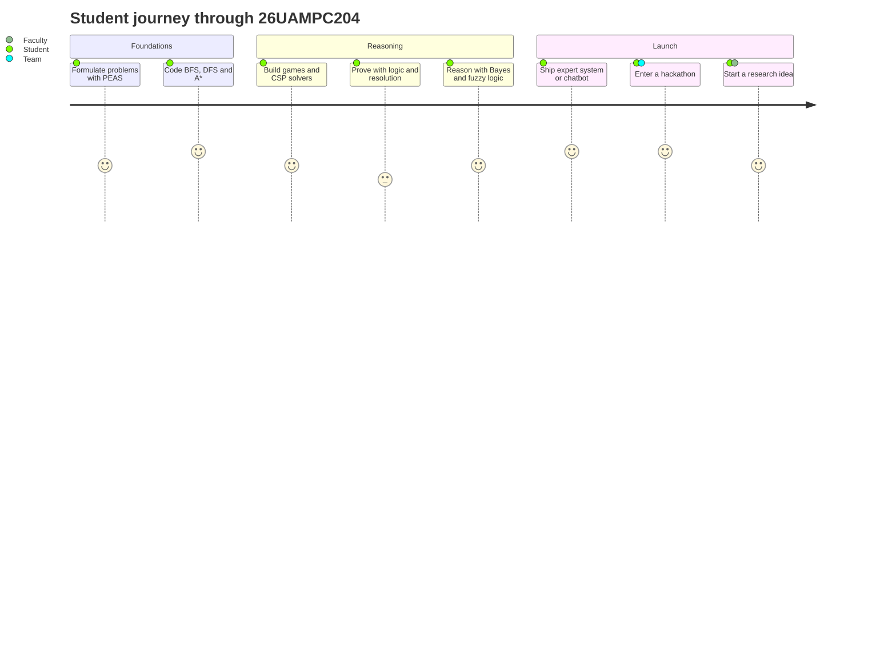

🎞️ Last-class deck: [Course_Finale_Skill_Outcome.pptx](02_PPT/Course_Finale_Skill_Outcome.pptx) ([PDF](02_PPT/pdf/Course_Finale_Skill_Outcome.pdf)) · 🪪 Skill passport for faculty sign-off: [AI_Career_Launchpad.pdf](10_Career_Launchpad/AI_Career_Launchpad.pdf)

---

## 🚀 Quick start

```bash
git clone https://github.com/drssnaiml1-cell/26UAMPC204-Artificial-Intelligence.git
cd 26UAMPC204-Artificial-Intelligence
pip install -r requirements.txt
jupyter lab 06_Notebooks/                                   # run any experiment
python 06_Notebooks/python/Exp02_AStar_8Puzzle_Route.py    # or as a plain script
bash build_all.sh                                           # rebuild every PDF, notebook and deck
```

Open any notebook in Google Colab by replacing `github.com` with `githubtocolab.com` in its URL.

<details>
<summary><b>📁 Repository structure</b></summary>

```
26UAMPC204-Artificial-Intelligence/
├── 00_Syllabus/            official syllabus (.docx)
├── 01_Unit_Notes/          latex/ + pdf/ (5 units + complete notes)
├── 02_PPT/                 animated decks (.pptx) + pdf/ + src/
├── 03_Question_Bank/       150 BTL questions (.tex/.pdf/.md)
├── 04_Projects/            50 projects (.tex/.pdf/.md)
├── 05_Lab_Manual/          Handbook Edition + DSY_Official_Edition/
├── 06_Notebooks/           10 executed experiments + python/ scripts
├── 07_Interview_Prep/      skills, 75 Q&A, coding solutions
├── 08_Research_Ideas/      20 research directions
├── 09_Assignments/         5 assignments + starter notebooks
├── 10_Career_Launchpad/    skill outcome, hackathons, conferences, journals
├── assets/                 logo, animated banner, figures, GIF animations
├── common/ai204.sty        shared LaTeX style (navy & gold, Times)
├── build_all.sh            one-command rebuild
└── requirements.txt
```
</details>

---

## 📖 Learning resources

**Text books**
1. Russell, S., & Norvig, P. (2021). *Artificial Intelligence: A Modern Approach* (4th ed.). Pearson. ISBN 978-0134610993.
2. Rich, E., Knight, K., & Nair, S. B. (2017). *Artificial Intelligence* (3rd ed.). McGraw Hill Education. ISBN 978-0070087705.

**Reference books**
1. Luger, G. F. (2008). *Artificial Intelligence: Structures and Strategies for Complex Problem Solving* (6th ed.). Pearson. ISBN 978-0321545893.
2. Nilsson, N. J. (1998). *Artificial Intelligence: A New Synthesis*. Morgan Kaufmann. ISBN 978-1558605350.
3. Patterson, D. W. (2007). *Introduction to Artificial Intelligence and Expert Systems*. PHI Learning. ISBN 978-8120305779.

**Online (NPTEL)**
- [An Introduction to Artificial Intelligence — Prof. Mausam, IIT Delhi](https://archive.nptel.ac.in/courses/106/102/106102220/)
- [Fundamentals of Artificial Intelligence — Prof. S. M. Hazarika, IIT Guwahati](https://archive.nptel.ac.in/courses/112/103/112103280/)
- [Artificial Intelligence — Prof. P. Dasgupta, IIT Kharagpur](https://archive.nptel.ac.in/courses/106/105/106105079/)

---

<p align="center">
  <br>
  <b>Dr. S. Satyanarayana</b>, Ph.D., PDF (AI)<br>
  Professor &amp; Advisor, AI &amp; Data Science, Sanjivani University, Kopargaon<br>
  <a href="https://orcid.org/0000-0001-8285-113X">ORCID</a> · <a href="https://scholar.google.com/citations?user=4Oo8gqoAAAAJ">Google Scholar</a> · <a href="https://github.com/drssnaiml1-cell">GitHub</a><br>
  <sub>© 2026 Dr. S. Satyanarayana · Course material for academic use · Academic Year 2026–27</sub>
</p>
